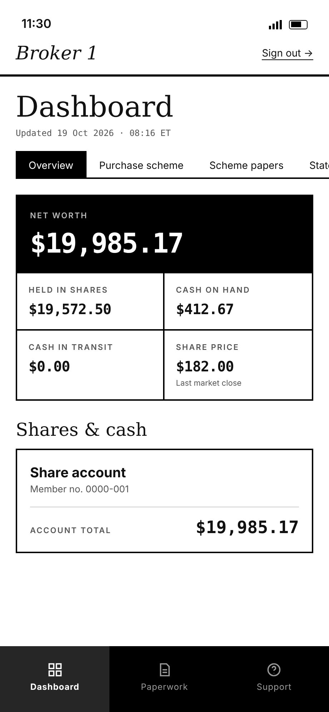
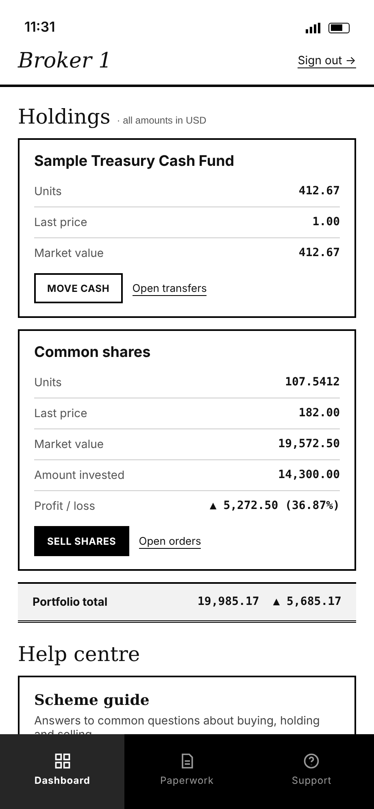
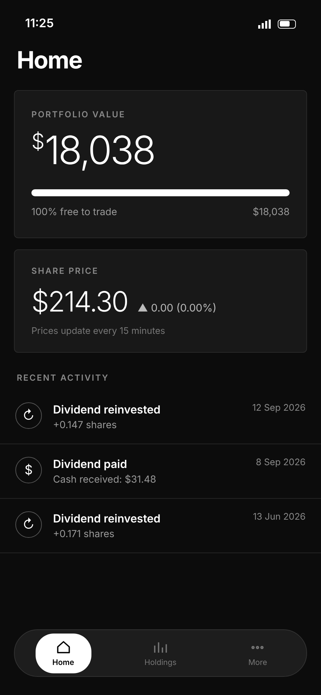
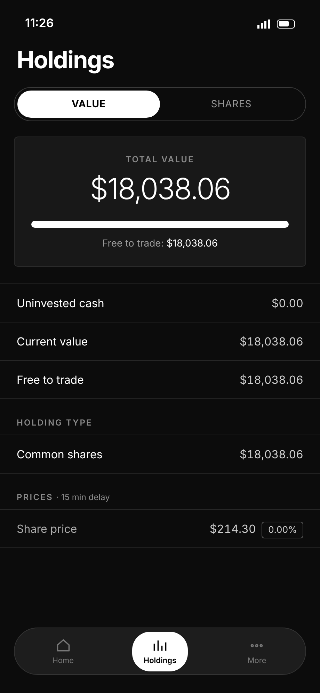
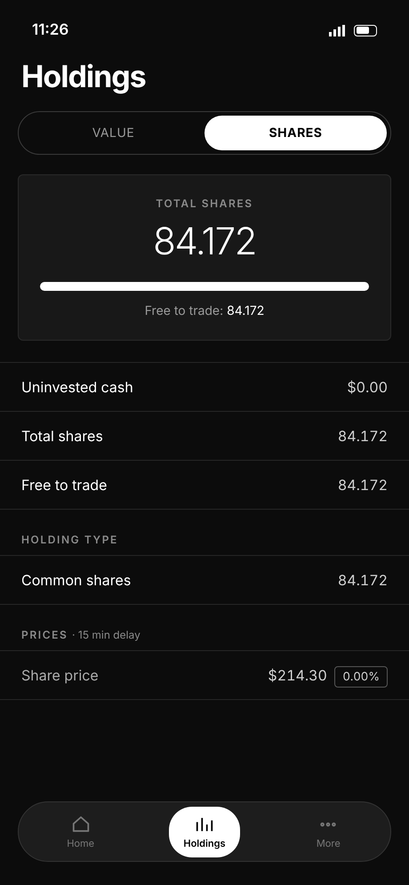
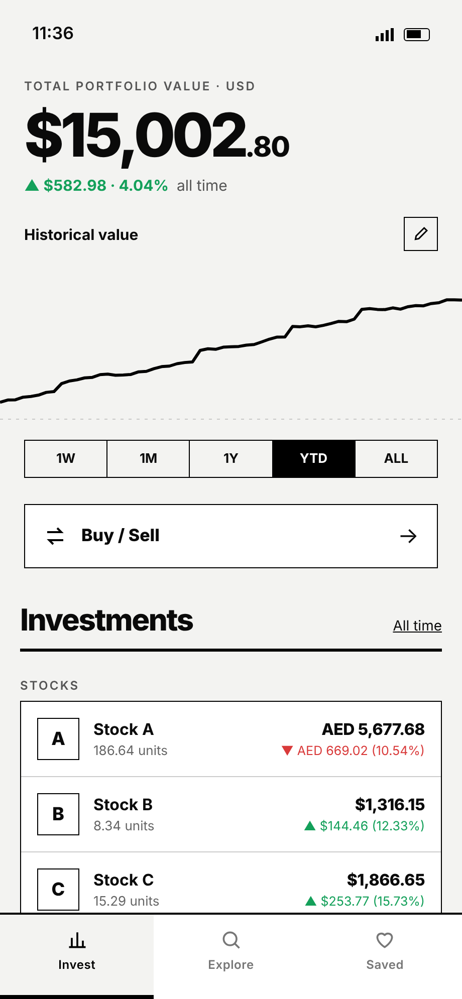
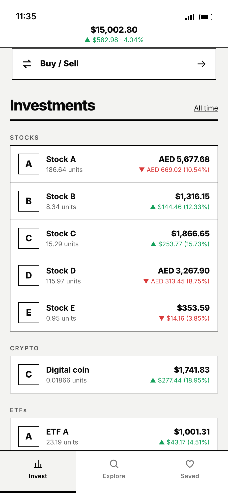
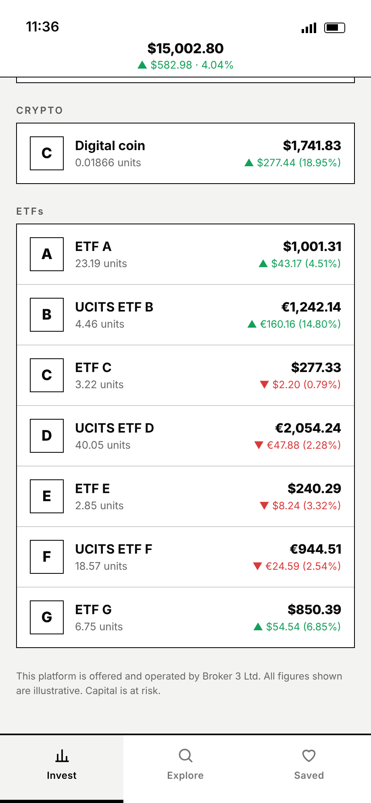

# Problem Domain: Three brokers, one investor

Imagine these are three investment platforms you use today. Each platform works independently. **Do not design a solution yet.** First experience what each platform can and cannot tell you.

> The screenshots below are fictional workshop mockups. The displayed values are fictional scenario data, not participant data. Select any screenshot to open the full-size image.

## Broker 1 — useful detail, narrow slice

  
  &nbsp;&nbsp;
  

Ask yourself:
- What can you tell about the investment held here?
- What historical context can you see?
- What could this app not answer about everything you own elsewhere?

## Broker 2 — another isolated holding

  
  &nbsp;
  
  &nbsp;
  

Ask yourself:
- What does this broker tell you about this holding?
- Is the information presented in the same form as Broker 1?
- If you use both brokers, where do you look to understand the combined picture?

## Broker 3 — richer experience, still only one platform

  
  &nbsp;
  
  &nbsp;
  

Ask yourself:
- What can you understand here that was harder in Brokers 1 and 2?
- Does this now represent everything you own?
- What happens to holdings that remain at Brokers 1 and 2?
- Where would a single historical view across all three platforms come from?

## Step back

Each broker can describe the slice it holds. Even the richest experience still sees only its own platform.

Carry this question into Design Thinking:

> **How do I keep track of all my holdings in one place?**

Do not answer it yet.
